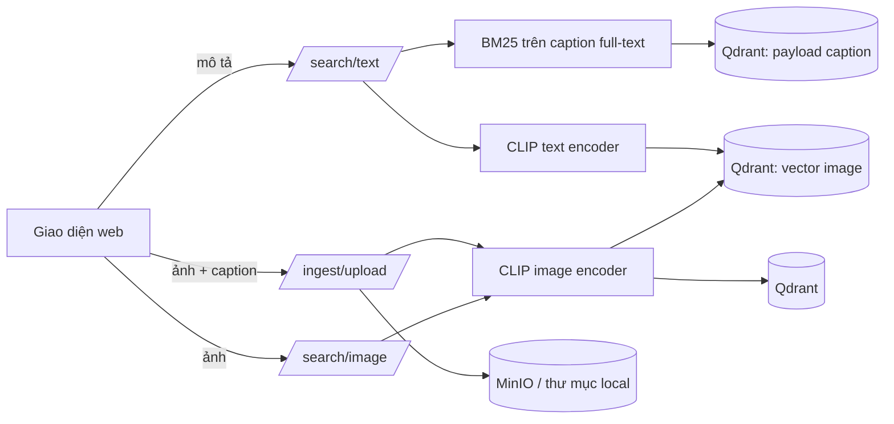

# KIS Architect: Kho ảnh kiến trúc Việt Nam

Hệ thống tìm kiếm kho ảnh công trình kiến trúc Việt Nam theo hai cách:

| Người dùng tìm bằng | Hệ thống xử lý |
|---|---|
| **Hình ảnh** (chọn file, kéo thả, dán Ctrl+V) | Mã hóa ảnh bằng **CLIP ViT-B/32 đã fine-tune** trên bộ dữ liệu rồi so cosine với vector ảnh trong kho → trả về ảnh tương đồng |
| **Mô tả bằng chữ** | Trộn 2 nhánh bằng Reciprocal Rank Fusion: (1) so từ khóa bằng BM25 trên chỉ mục full-text của caption, (2) mã hóa câu truy vấn bằng **text encoder của CLIP** và so trực tiếp với vector ảnh, nên hiểu được cách diễn đạt khác và cả chi tiết có trong ảnh mà caption không nhắc tới. Từ khớp được tô vàng trong kết quả |

Mỗi ảnh trong Qdrant có **vector `image`** (CLIP) và payload chứa caption gốc cùng metadata (tên công trình, tác giả, giấy phép, nguồn Wikimedia…). Caption lấy từ `scripts/compare_output/captions_final.csv` (kết quả so sánh caption Qwen và Gemma 4).



---

## Chạy hệ thống

### 1. Cài thư viện

```bash
pip install -r requirements.txt
```

### 2. Khởi động Qdrant và MinIO

```bash
docker-compose up -d
```

Không dùng Docker? Tạo `backend/.env` với `QDRANT_MODE=local` và `STORAGE_BACKEND=local` (xem `backend/env.example`). Khi đó Qdrant lưu vào thư mục `qdrant_local/`, ảnh dataset đọc trực tiếp từ `data/vietnam_architecture/`.

### 3. Lập chỉ mục ảnh + caption (chạy một lần)

```bash
python scripts/index_dataset.py --limit 200   # thử nhanh 200 ảnh
python scripts/index_dataset.py               # toàn bộ 7.756 ảnh, tự bỏ qua ảnh đã có
```

* Script và trang "Thêm ảnh vào kho" là hai cách nạp vào **cùng một kho**: ảnh nạp theo cách nào cũng được lưu, mã hóa và tìm kiếm như nhau. Script chỉ tiện hơn khi nạp hàng loạt từ CSV.

* Đọc `scripts/compare_output/captions_final.csv`; ảnh được tìm **theo tên file** trong `data/vietnam_architecture/` (không phụ thuộc đường dẫn cũ trong CSV), metadata đọc từ file `.json` cùng tên.
* `--recreate`: xóa collection và nạp lại (bắt buộc khi đổi model nhúng).
* `--yolo`: nhận diện thêm cấu kiện kiến trúc bằng YOLO-World để lọc theo cấu kiện (chậm).
* Lần đầu chạy sẽ tải CLIP (~340 MB).

### 4. Fine-tune CLIP và dùng trong hệ thống

CLIP gốc học từ ảnh đại trà trên internet nên phân biệt kém các kiểu kiến trúc Việt Nam. Script dưới đây fine-tune CLIP bằng chính các cặp (ảnh, caption) trong `captions_final.csv` (loss contrastive như CLIP gốc, caption đóng vai trò nhãn):

```bash
python scripts/dedup_images.py                              # khử trùng CLIP + ORB -> data/vietnam_architecture/dedup/
python scripts/finetune_clip.py --resplit --device cuda --augment --grad-checkpoint --workers 12  # chia lại ngẫu nhiên theo ảnh + train
python scripts/finetune_clip.py --device cuda --augment --grad-checkpoint --workers 12   # cấu hình chốt, GPU 4GB
python scripts/kfold_clip.py -- --device cuda --augment --grad-checkpoint --workers 12  # 5-fold (~4 giờ)
python scripts/finetune_clip.py --aug-preview               # chỉ lưu ảnh minh họa tăng cường (aug_preview.png)
python scripts/finetune_clip.py --eval-only                 # in lại bảng so sánh CLIP gốc / fine-tuned trên tập test
```

* **Khử trùng** (`scripts/dedup_images.py`): chỉ dùng CLIP và ORB. Một cặp ảnh là trùng nếu cosine CLIP ≥ 0,97 (bản sao: cắt, chỉnh màu, nén lại), hoặc cosine 0,90–0,97 và ORB + RANSAC có ≥ 40 điểm khớp (cùng cảnh, cùng góc chụp). Gom bằng union-find, mỗi cụm giữ 1 ảnh có độ phân giải lớn nhất. `pairs_*.jpg` là ảnh ghép mẫu từng vùng ngưỡng để kiểm tra bằng mắt.
* **Chia train/val/test** 80/10/10 ngẫu nhiên theo ảnh (`split.json`, hạt giống 42): sau khử trùng mỗi ảnh là một nhóm riêng. Kiểm tra chống rò rỉ vẫn chạy mỗi lần; split cũ không khớp thì dùng `--resplit`. Checkpoint được chọn theo val, kết quả báo cáo trên test.
* **Chống overfit** (mặc định): `--drop-path 0.1` (stochastic depth cho các block đang train) cùng tăng cường ảnh. `--group-mask` mặc định tắt, chỉ có tác dụng khi dữ liệu còn ảnh cùng cảnh.
* **Tăng cường ảnh, chỉ trên tập train** (`scripts/image_preprocess.py`): xoay ±8°/phối cảnh nhẹ, cắt ngẫu nhiên (giữ ≥ 50% diện tích), lật ngang, sắc độ (sáng, tương phản, bão hòa, hue), xám hóa, làm mờ/nét, xóa vùng nhỏ. Chính sách *hiểu caption*: caption có trái/phải hoặc chữ/biển hiệu thì không lật; caption nhắc màu thì không đổi hue/không xám hóa; caption nói về ánh sáng thì giảm biên độ độ sáng. `--aug-views V` tạo trước V biến thể cho mỗi ảnh train và cache phần đóng băng (vẫn chạy được trên CPU); `--augment` tăng cường trực tuyến mỗi bước (nên dùng GPU). Val/test chỉ qua preprocess xác định của CLIP, chuẩn hóa bằng mean/std cố định của CLIP, nên không có rò rỉ dữ liệu.
* Chỉ mở khóa 4 block Transformer cuối của mỗi nhánh (ảnh, văn bản) cùng lớp chiếu, khoảng 27% tham số. Phần đóng băng được tính một lần rồi cache lại, nên mỗi epoch chỉ mất vài phút trên CPU.
* Đánh giá: Recall@K text→ảnh và ảnh→text; ảnh→ảnh đo bằng P@10/mAP@10, trong đó "liên quan" nghĩa là có chung category Wikimedia Commons cụ thể (category không dùng khi train).
* Đầu ra nằm ở `models/clip_finetuned/`: `clip_vitb32_kis.pt` (chỉ phần trọng số đã train, nạp chồng lên CLIP gốc) và `metrics.json`.
* Hình và bảng cho báo cáo: `python scripts/make_finetune_report.py` → `reports/clip_finetune/` (4 hình PNG 300 dpi + `bang_ket_qua.md`).

Kết quả trên tập test (759 ảnh, sau khử trùng và chia theo nhóm; checkpoint epoch 20/20, GPU khoảng 3 phút/epoch):

| Chỉ số | CLIP gốc | Fine-tuned |
|---|---:|---:|
| Text→ảnh R@1 / R@5 / R@10 (gallery 759 ảnh test) | 43.5 / 74.6 / 82.7 | **70.2 / 94.9 / 98.9** |
| Ảnh→text R@1 / R@5 / R@10 | 46.1 / 74.2 / 82.7 | **68.5 / 95.1 / 98.3** |
| Text→ảnh trên toàn kho 7.583 ảnh, R@1 / R@10 / R@50 | 19.6 / 56.9 / 79.1 | **45.7 / 88.5 / 98.8** |
| Text→ảnh / ảnh→text R@1 theo nhóm (ảnh cùng nhóm không tính là sai) | 54.5 / 55.1 | **84.5 / 82.9** |
| Ảnh→ảnh P@10 / mAP@10 (chung category Commons) | 51.4 / 47.0 | **57.2 / 52.9** |

Đánh giá chéo 5-fold theo nhóm (`models/clip_finetuned/kfold_summary.json`; mỗi fold 80/10/10, test các fold không chồng nhau): text→ảnh R@1 **70.8 ± 1.4** (CLIP gốc 44.5 ± 1.3), toàn kho R@1 **46.5 ± 1.4** (22.0 ± 2.1), R@1 theo nhóm **84.4 ± 2.5**, ảnh→ảnh mAP@10 **51.4 ± 1.9** (45.7 ± 1.6); khoảng cách train/val (R@1 theo nhóm) 9.8 ± 1.2 điểm, val loss đi ngang không tăng lại. Bản trước khi khử trùng/chia theo nhóm đạt R@1 76.8 trên một tập test khác; con số đó cao hơn một phần vì ảnh trùng/cùng cảnh lẫn giữa train và test.

Dùng mô hình fine-tune trong backend:

```bash
# backend/.env
CLIP_FINETUNED_PATH=models/clip_finetuned/clip_vitb32_kis.pt
```

```bash
python scripts/reembed_images.py   # tính lại vector ảnh trong Qdrant, giữ nguyên caption/metadata/ảnh tải lên
```

Phải chạy lại `reembed_images.py` mỗi khi đổi `CLIP_FINETUNED_PATH`, vì vector của CLIP gốc và CLIP fine-tune không so được với nhau. `GET /api/v1/stats` cho biết mô hình đang dùng (`clip-ViT-B/32-ft`).

### 5. Chạy backend (đồng thời phục vụ giao diện)

```bash
cd backend
python -m uvicorn app.main:app --port 8000
```

* Giao diện: **http://localhost:8000/**
* Tài liệu API: http://localhost:8000/docs

> Giao diện tĩnh vẫn mở được bằng `python -m http.server 5500` trong thư mục `frontend/`; khi đó nó tự gọi API ở cổng 8000.

---

## Sử dụng

**Tìm kiếm**
* *Bằng mô tả*: gõ câu tiếng Anh (caption là tiếng Anh), ví dụ `red brick Cham tower with a stepped roof`. Mặc định kết hợp cả 2 nhánh; có thể chọn chỉ so từ khóa hoặc chỉ so nội dung ảnh (CLIP). Kết quả do nhánh CLIP tìm ra có nhãn "ảnh".
* *Bằng hình ảnh*: kéo thả, chọn file hoặc dán ảnh (Ctrl+V ở bất kỳ đâu trên trang tìm kiếm).
* Bấm một ảnh để xem caption đầy đủ, metadata, nguồn gốc và **Tìm ảnh tương đồng** (dùng lại vector đã lưu, không mã hóa lại).
* Lọc theo cấu kiện (khi đã chạy YOLO).

**Thêm ảnh vào kho** (mỗi ảnh bắt buộc có caption)
1. Chọn hoặc kéo thả nhiều ảnh. Có thể chọn kèm file `.txt` cùng tên làm caption.
2. Gắn caption: gõ trực tiếp từng ô, hoặc nhập file CSV/JSON/JSONL (ghép theo tên ảnh). Ảnh thiếu caption được đánh dấu đỏ; nút nạp chỉ bật khi mọi ảnh đều có caption.
3. Thông tin chung (tùy chọn): tên bộ sưu tập, thể loại, mô tả, bật YOLO-World.
4. Sau khi nạp: xem các ảnh vừa nạp, hoặc **hoàn tác** cả lần nạp.

Định dạng CSV caption giống `captions_final.csv`:

```csv
filepath,caption
chua_mot_cot.jpg,"A small wooden pagoda on a single stone pillar in a lotus pond."
```

---

## API chính

| Method | Đường dẫn | Mô tả |
|---|---|---|
| POST | `/api/v1/search/text` | `{"query", "limit", "mode": "hybrid\|keyword\|visual", "object_labels"}` |
| POST | `/api/v1/search/image` | `{"image_base64", "limit", ...bộ lọc}` |
| POST | `/api/v1/search/image/upload` | multipart `file` (tiện thử trên Swagger) |
| GET | `/api/v1/images/similar?key=` | Ảnh tương đồng với một ảnh trong kho |
| GET | `/api/v1/images/list?batch_id=` | Duyệt ảnh của một lần tải lên |
| POST | `/api/v1/ingest/upload` | multipart `files[]` + `captions` (JSON mảng hoặc `{tên_file: caption}`) + `batch_name`, `categories`, `description`, `detect_objects` |
| DELETE | `/api/v1/ingest/batches/{batch_id}` | Hoàn tác một lần tải lên |
| GET | `/api/v1/stats` | Số ảnh, model đang dùng, nhãn cấu kiện |
| GET | `/media/{key}` | Ảnh gốc (file local hoặc chuyển hướng presigned URL MinIO) |

## Test

```bash
cd backend
PYTHONPATH=tests python -m pytest -q
```

Test chạy với Qdrant in-memory và embedder `lite` (không cần Docker, GPU hay tải model).

## Cấu trúc mã nguồn

```
backend/app/
  config.py                  cấu hình (đọc backend/.env)
  api/endpoints/search.py    tìm bằng ảnh, bằng mô tả (caption), ảnh tương đồng
  api/endpoints/ingest.py    nạp ảnh + caption, hoàn tác
  api/endpoints/media.py     phục vụ ảnh
  database/vector_store.py   Qdrant: 2 vector có tên, BM25 trên caption
  services/embedders.py      CLIP (gốc hoặc fine-tune) cho ảnh và câu truy vấn (và bản lite cho test)
  services/indexer.py        dựng payload + lập chỉ mục dùng chung
  services/storage.py        MinIO hoặc thư mục local
  services/yolo_service.py   YOLO-World (tùy chọn)
frontend/                    index.html, styles.css, script.js
scripts/index_dataset.py     nạp captions_final.csv vào Qdrant
scripts/finetune_clip.py     fine-tune CLIP trên cặp ảnh-caption, đánh giá trước/sau
scripts/reembed_images.py    tính lại vector ảnh khi đổi mô hình CLIP
scripts/make_finetune_report.py  sinh hình + bảng kết quả fine-tune vào reports/clip_finetune/
models/clip_finetuned/       checkpoint fine-tune, metrics.json, split.json
scripts/compare_captions.py  so sánh caption 2 VLM, sinh captions_final.csv
```
