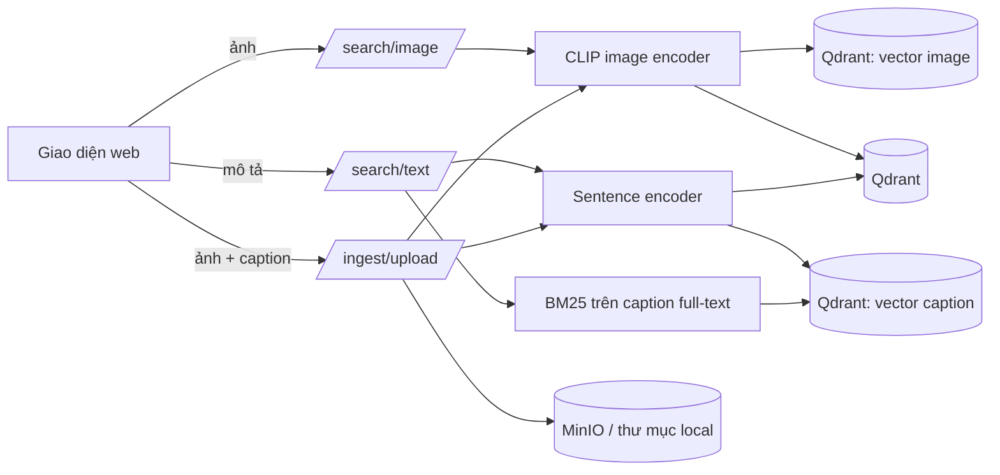

# KIS Architect: Kho ảnh kiến trúc Việt Nam

Hệ thống tìm kiếm kho ảnh công trình kiến trúc Việt Nam theo hai cách:

| Người dùng tìm bằng | Hệ thống xử lý |
|---|---|
| **Hình ảnh** (chọn file, kéo thả, dán Ctrl+V) | Mã hóa ảnh bằng **CLIP ViT-B/32** rồi so cosine với vector ảnh trong kho → trả về ảnh tương đồng |
| **Mô tả bằng chữ** | **Truy vấn trên caption** của từng ảnh: (1) so ngữ nghĩa câu truy vấn với vector caption (sentence-transformers), (2) so từ khóa bằng BM25 trên chỉ mục full-text của caption, rồi trộn hai danh sách bằng Reciprocal Rank Fusion. Từ khớp được tô vàng trong kết quả |

Mỗi ảnh trong Qdrant có **2 vector có tên** (`image`, `caption`) và payload chứa caption gốc cùng metadata (tên công trình, tác giả, giấy phép, nguồn Wikimedia…). Caption lấy từ `scripts/compare_output/captions_final.csv` (kết quả so sánh caption Qwen và Gemma 4).



---

## Chạy hệ thống

### 1. Cài thư viện

```bash
pip install -r requirements.txt
```

### 2. Khởi động Qdrant và MinIO

```bash
docker-compose up -d qdrant minio mc
```

Không dùng Docker? Tạo `backend/.env` với `QDRANT_MODE=local` và `STORAGE_BACKEND=local` (xem `backend/env.example`). Khi đó Qdrant lưu vào thư mục `qdrant_local/`, ảnh dataset đọc trực tiếp từ `data/vietnam_architecture/`.

### 3. Lập chỉ mục ảnh + caption (chạy một lần)

```bash
python scripts/index_dataset.py --limit 200   # thử nhanh 200 ảnh
python scripts/index_dataset.py               # toàn bộ 7.756 ảnh, tự bỏ qua ảnh đã có
```

* Đọc `scripts/compare_output/captions_final.csv`; ảnh được tìm **theo tên file** trong `data/vietnam_architecture/` (không phụ thuộc đường dẫn cũ trong CSV), metadata đọc từ file `.json` cùng tên.
* `--recreate`: xóa collection và nạp lại (bắt buộc khi đổi model nhúng).
* `--yolo`: nhận diện thêm cấu kiện kiến trúc bằng YOLO-World để lọc theo cấu kiện (chậm).
* Lần đầu chạy sẽ tải CLIP (~340 MB) và all-mpnet-base-v2 (~420 MB; đã có sẵn nếu từng chạy `compare_captions.py`).

### 4. Chạy backend (đồng thời phục vụ giao diện)

```bash
cd backend
python -m uvicorn app.main:app --port 8000
```

* Giao diện: **http://localhost:8000/**
* Tài liệu API: http://localhost:8000/docs

> Giao diện tĩnh vẫn mở được bằng `python -m http.server 5500` trong thư mục `frontend/`; khi đó nó tự gọi API ở cổng 8000.

---

## Sử dụng

**Tìm kiếm**
* *Bằng mô tả*: gõ câu tiếng Anh (caption là tiếng Anh), ví dụ `red brick Cham tower with a stepped roof`. Có thể chọn chỉ so ngữ nghĩa hoặc chỉ so từ khóa.
* *Bằng hình ảnh*: kéo thả, chọn file hoặc dán ảnh (Ctrl+V ở bất kỳ đâu trên trang tìm kiếm).
* Bấm một ảnh để xem caption đầy đủ, metadata, nguồn gốc và **Tìm ảnh tương đồng** (dùng lại vector đã lưu, không mã hóa lại).
* Lọc theo nguồn (bộ dữ liệu gốc / ảnh tải lên) và theo cấu kiện (khi đã chạy YOLO).

**Thêm ảnh vào kho** (mỗi ảnh bắt buộc có caption)
1. Chọn hoặc kéo thả nhiều ảnh. Có thể chọn kèm file `.txt` cùng tên làm caption.
2. Gắn caption: gõ trực tiếp từng ô, hoặc nhập file CSV/JSON/JSONL (ghép theo tên ảnh). Ảnh thiếu caption được đánh dấu đỏ; nút nạp chỉ bật khi mọi ảnh đều có caption.
3. Thông tin chung (tùy chọn): tên bộ sưu tập, thể loại, mô tả, bật YOLO-World.
4. Sau khi nạp: xem các ảnh vừa nạp, hoặc **hoàn tác** cả lần nạp.

Định dạng CSV caption giống `captions_final.csv`:

```csv
filepath,caption
chua_mot_cot.jpg,"A small wooden pagoda on a single stone pillar in a lotus pond."
```

---

## API chính

| Method | Đường dẫn | Mô tả |
|---|---|---|
| POST | `/api/v1/search/text` | `{"query", "limit", "mode": "hybrid\|semantic\|keyword", "source", "object_labels"}` |
| POST | `/api/v1/search/image` | `{"image_base64", "limit", ...bộ lọc}` |
| POST | `/api/v1/search/image/upload` | multipart `file` (tiện thử trên Swagger) |
| GET | `/api/v1/images/similar?key=` | Ảnh tương đồng với một ảnh trong kho |
| GET | `/api/v1/images/list?batch_id=` | Duyệt ảnh của một lần tải lên |
| POST | `/api/v1/ingest/upload` | multipart `files[]` + `captions` (JSON mảng hoặc `{tên_file: caption}`) + `batch_name`, `categories`, `description`, `detect_objects` |
| DELETE | `/api/v1/ingest/batches/{batch_id}` | Hoàn tác một lần tải lên |
| GET | `/api/v1/stats` | Số ảnh, model đang dùng, nhãn cấu kiện |
| GET | `/media/{key}` | Ảnh gốc (file local hoặc chuyển hướng presigned URL MinIO) |

## Test

```bash
cd backend
python -m pytest -q
```

Test chạy với Qdrant in-memory và embedder `lite` (không cần Docker, GPU hay tải model).

## Cấu trúc mã nguồn

```
backend/app/
  config.py                  cấu hình (đọc backend/.env)
  api/endpoints/search.py    tìm bằng ảnh, bằng mô tả (caption), ảnh tương đồng
  api/endpoints/ingest.py    nạp ảnh + caption, hoàn tác
  api/endpoints/media.py     phục vụ ảnh
  database/vector_store.py   Qdrant: 2 vector có tên, BM25 trên caption
  services/embedders.py      CLIP / sentence-transformers (và bản lite cho test)
  services/indexer.py        dựng payload + lập chỉ mục dùng chung
  services/storage.py        MinIO hoặc thư mục local
  services/yolo_service.py   YOLO-World (tùy chọn)
frontend/                    index.html, styles.css, script.js
scripts/index_dataset.py     nạp captions_final.csv vào Qdrant
scripts/compare_captions.py  so sánh caption 2 VLM, sinh captions_final.csv
```
