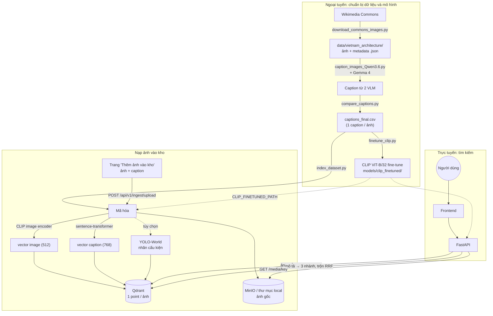

# Kiến trúc hệ thống KIS Architect

Hệ thống tìm kiếm kho ảnh công trình kiến trúc Việt Nam bằng **mô tả văn bản** hoặc **ảnh mẫu**. Tài liệu này mô tả luồng dữ liệu, vai trò từng thành phần và các quyết định thiết kế chính. Hướng dẫn cài đặt và chạy nằm ở [README.md](README.md).

## 1. Tổng quan

Script và trang "Thêm ảnh vào kho" là hai cách nạp vào **cùng một kho**: ảnh nạp theo cách nào cũng được lưu, mã hóa và tìm kiếm như nhau.

## 2. Dữ liệu

| Bước | Script | Đầu ra |
|---|---|---|
| Thu thập ảnh và metadata (tên công trình, category, tác giả, giấy phép, tọa độ) | `download_commons_images.py` | `data/vietnam_architecture/*.png` + `*.json` |
| Sinh caption tiếng Anh bằng 2 VLM (Qwen 3.6, Gemma 4) theo `scripts/prompt.md` | `caption_images_Qwen3.6.py` | `caption_project_*/captions_clip.csv` |
| So sánh 2 bộ caption bằng cosine sentence-embedding, hiệu chỉnh ngưỡng, rà soát thủ công, chọn caption cuối | `compare_captions.py` (+ `embed_images_xlsx.py` để xem ảnh trong Excel) | `compare_output/captions_final.csv` (7.756 ảnh) |

## 3. Lưu trữ

**Qdrant** (`kis_architecture`): mỗi ảnh là một point, ID cố định theo key ảnh (nạp lại thì ghi đè, không nhân bản), gồm:

* vector `image` (512 chiều, CLIP): tìm bằng ảnh và nhánh CLIP của tìm bằng mô tả;
* vector `caption` (768 chiều, `all-mpnet-base-v2`): nhánh ngữ nghĩa;
* payload: caption (có chỉ mục full-text cho BM25), metadata Commons, nhãn YOLO, `batch_id` của lần tải lên (để hoàn tác), `image_model` (mô hình đã sinh vector ảnh).

Qdrant chạy bằng Docker (`QDRANT_MODE=server`) hoặc lưu vào thư mục `qdrant_local/` (`local`, chỉ một tiến trình được mở cùng lúc).

**Ảnh gốc**: MinIO (`STORAGE_BACKEND=minio`) hoặc thư mục máy (`local`). Frontend luôn lấy ảnh qua `GET /media/{key}`; backend trả file trực tiếp hoặc chuyển hướng sang presigned URL của MinIO, nên giao diện không phụ thuộc kiểu lưu trữ.

## 4. Mô hình

### CLIP ViT-B/32 (fine-tune)

CLIP gồm image encoder và text encoder chiếu về cùng không gian 512 chiều. Bản gốc của OpenAI học từ ảnh đại trà trên internet nên phân biệt kém các kiểu kiến trúc Việt Nam; hệ thống dùng bản đã fine-tune trên chính các cặp (ảnh, caption) của kho:

* loss contrastive đối xứng (InfoNCE) như CLIP gốc, caption đóng vai trò nhãn;
* chỉ mở khóa 4 block Transformer cuối của mỗi nhánh cùng lớp chiếu (27,5% tham số) để không làm mất kiến thức gốc;
* phần bị đóng băng được tính một lần rồi cache lại, nên train được trên CPU;
* chia train/val/test 80/10/10 theo nhóm ảnh trùng, chọn checkpoint theo val, báo cáo trên test.

Trên tập test, Recall@1 văn bản → ảnh tăng từ 47,2% lên 76,8%; ảnh → ảnh (P@10, chung công trình) tăng từ 53,5% lên 57,5%. Hình và bảng đầy đủ ở `reports/clip_finetune/`.

Checkpoint chỉ chứa phần trọng số đã train và được nạp chồng lên CLIP gốc khi đặt `CLIP_FINETUNED_PATH`. Đổi mô hình thì phải tính lại vector ảnh bằng `reembed_images.py`, vì vector của hai mô hình không so được với nhau.

### Sentence-transformer `all-mpnet-base-v2`

Mã hóa caption và câu truy vấn thành vector 768 chiều cho nhánh ngữ nghĩa. Đây cũng là mô hình dùng để so sánh caption ở bước chuẩn bị dữ liệu.

### YOLO-World (tùy chọn)

Phát hiện đối tượng từ vựng mở với danh sách cấu kiện kiến trúc định nghĩa trong `yolo_service.py` (bell tower, curved roof, dragon carving, stele, colonnade...), chọn theo ngữ cảnh category của ảnh. Nhãn được lưu vào payload để lọc theo cấu kiện. Chỉ chạy khi bật `--yolo` lúc nạp bằng script hoặc tích chọn khi tải lên, vì khá chậm.

## 5. Tìm kiếm

**Bằng ảnh**: mã hóa ảnh mẫu bằng CLIP image encoder, tìm cosine trên vector `image`. "Tìm ảnh tương đồng" với một ảnh trong kho dùng lại vector đã lưu, không mã hóa lại.

**Bằng mô tả**: ba nhánh chạy song song rồi trộn bằng Reciprocal Rank Fusion (RRF, k = 60):

| Nhánh | So câu truy vấn với | Cách so | Mạnh ở |
|---|---|---|---|
| Từ khóa | caption | BM25 trên chỉ mục full-text (biểu diễn thưa) | tên riêng, từ chính xác |
| Ngữ nghĩa | caption | cosine giữa vector sentence-transformer (biểu diễn dày) | từ đồng nghĩa, cách diễn đạt khác |
| Nội dung ảnh | ảnh | cosine giữa vector CLIP text và vector `image` | chi tiết có trong ảnh nhưng caption không nhắc tới |

Ở chế độ kết hợp, kết quả chỉ đến từ nhánh ngữ nghĩa phải có cosine ≥ 0,2; kết quả chỉ đến từ nhánh CLIP phải có cosine ≥ 0,2 và không kém kết quả CLIP tốt nhất của câu đó quá 0,03 (ngưỡng tương đối vì cosine văn bản–ảnh phụ thuộc độ dài câu). Người dùng có thể chọn chạy riêng từng nhánh. Mỗi kết quả ghi rõ nhánh nào đã tìm ra nó.

Mọi kiểu tìm đều lọc được theo nhãn cấu kiện YOLO.

## 6. API

| Method | Đường dẫn | Chức năng |
|---|---|---|
| POST | `/api/v1/search/text` | Tìm bằng mô tả; `mode`: `hybrid`, `semantic`, `keyword`, `visual` |
| POST | `/api/v1/search/image` | Tìm bằng ảnh (base64) |
| POST | `/api/v1/search/image/upload` | Tìm bằng ảnh (multipart, tiện thử trên Swagger) |
| GET | `/api/v1/images/similar?key=` | Ảnh tương đồng với một ảnh trong kho |
| GET | `/api/v1/images/list?batch_id=` | Các ảnh của một lần tải lên |
| GET | `/api/v1/images/item?key=` | Thông tin một ảnh |
| POST | `/api/v1/ingest/upload` | Nạp ảnh + caption (bắt buộc), tùy chọn chạy YOLO |
| DELETE | `/api/v1/ingest/batches/{batch_id}` | Hoàn tác một lần tải lên |
| GET | `/api/v1/stats` | Số ảnh, mô hình đang dùng, nhãn cấu kiện |
| GET | `/media/{key}` | Ảnh gốc |
| GET | `/health`, `/health/qdrant` | Kiểm tra tình trạng |

## 7. Công nghệ

| Lớp | Công nghệ |
|---|---|
| Giao diện | HTML, CSS, JavaScript thuần; backend phục vụ tại cổng 8000 |
| API | FastAPI, Uvicorn, Pydantic |
| Mô hình | PyTorch, OpenAI CLIP, sentence-transformers, Ultralytics YOLO-World |
| Vector DB | Qdrant |
| Lưu ảnh | MinIO (S3) hoặc thư mục local |
| Test | pytest, Qdrant in-memory, embedder `lite` (không cần GPU hay tải mô hình) |
